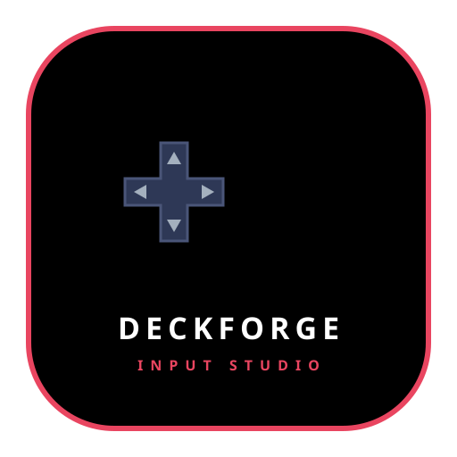

<div align="center">



# DeckForge Input Studio
### Universal Visual Controller Mapper & Steam Input VDF Template Generator for Steam Deck

[](https://store.steampowered.com/steamos)
[](https://decky.xyz)
[](https://www.python.org/)
[](https://www.typescriptlang.org/)
[](https://docs.pytest.org/)
[](LICENSE)

</div>

---

**DeckForge Input Studio** is an interactive controller mapping application and Steam Input VDF template compiler designed specifically for SteamOS (Steam Deck) and remote workstations. It allows you to connect any physical input device—custom 3D-printed microcontrollers (RP2040 / GP2040-CE), rhythm game guitars (CRKD NEO S, Riffmaster, X-plorer), electronic USB-MIDI drum kits, fightsticks, macropads, or standard gamepads—visually map every axis, button, hat switch, and tilt/whammy sensor via an interactive SVG canvas, and compile those mappings directly into native Steam Input `.vdf` configuration templates that appear seamlessly inside Steam Gaming Mode's Controller Configurator.

---

## 🌟 Key Features

### 1. Dual-Mode Deployment
* **Decky Loader Plugin (`deckforge-input-studio`)**: Designed for native 1280×800 touch and gamepad navigation inside Steam Gaming Mode. Features a Quick Access Menu (QAM) sidebar panel for quick profile switching, live monitoring, and active template injection, plus a full-screen studio route registered at `/deckforge`.
* **Standalone Web Studio (`0.0.0.0:8765`)**: Built-in FastAPI + WebSocket server accessible wirelessly over **Tailscale** (`http://<steamdeck-ip>:8765/`). Map complex multi-layer configurations on a tablet or second monitor while simultaneously testing live input on the Deck.

### 2. 7 Interactive Hardware Blueprints
Visual vector chassis where physical inputs illuminate in real time and clicking any element opens its binding inspector:
* **Steam Deck (`neptune`) & Standard Gamepad**: Full face controls, analog stick position dots, L2/R2 analog travel fill bars, rear grip buttons (L4/L5/R4/R5), dual trackpads with touch coordinates, and a 3D IMU gyro orientation wireframe.
* **CRKD NEO S Pro Guitar**: Mechanical fret switches, solo frets, dual-switch spring-return strum bar, whammy half-axis normalization (`-32768..32767` → `0..1`), tilt Star Power activation, and battery/LED status gauges. Auto-detected via Vendor ID `0x2E95`.
* **GP2040-CE / RP2040 Riffstick**: 3D-printed modular guitar chassis (Raspberry Pi Pico VID `0x2E8A`), Cherry MX mechanical frets, rotary potentiometer whammy dial, and mercury/analog tilt sensor with one-click presets for Clone Hero and YARG.
* **Electronic Drum Kits & Synthesizers**: Native USB-MIDI (`mido` & ALSA raw `/dev/snd/midi*`). Captures `note_on` events (velocity 1–127) and `control_change`. Visual drum pads pulse with intensity proportional to strike force.
* **Arcade Fightstick & Leverless Hitbox**: 8-button arcade layout (punch and kick rows) with toggle between Sanwa JLF lever deflection and leverless Hitbox directional layout.
* **Dynamic Keyboard & Macropad Matrix**: Dynamic $N \times M$ grid generator with rotary encoder visualizers (position arc + center push button).
* **Universal Raw HID Canvas**: Auto-generates visual nodes for any unrecognized USB or Bluetooth controller's raw buttons (`BTN_0`..`BTN_31`) and analog axes (`ABS_X`..`ABS_RZ`).

### 3. Native Steam Input VDF Compiler Engine
* **Triple-Location Synchronization**: Writes atomically to all directories indexed by SteamOS Gaming Mode so templates appear instantly without being overwritten by Steam Cloud:
  1. `~/.local/share/Steam/steamapps/common/Steam Controller Configs/<USER_ID>/config/`
  2. `~/.local/share/Steam/userdata/<USER_ID>/241100/remote/` (Steam Cloud Remote Sync)
  3. `~/.local/share/Steam/userdata/<USER_ID>/config/controller_configs/templates/`
  4. `~/.config/deckforge/templates/` (Master local vault with `.vdf` and `.json` metadata)
* **Multi-Schema Variants**: Automatically compiles schemas for `controller_neptune`, `controller_xbox360`, `controller_ps4`, `controller_ps5`, and `controller_generic` so Steam never hides a template due to controller-type mismatch.
* **Non-Steam Shortcut 64-bit CRC32 Matching**: Computes accurate Steam Big Picture 64-bit shortcut IDs (`((crc32(exe + appname) | 0x80000000) << 32) | 0x02000000`) and 32-bit legacy IDs, ensuring seamless binding to Non-Steam games (Clone Hero, YARG, RPCS3, PCSX2).

### 4. Zero-Latency Engine & Safe Grab Watchdog
* **60Hz+ evdev Event Bus**: High-frequency normalized input streaming with sub-15ms response.
* **Fail-Safe Exclusive Grab**: "Press Any Button to Bind" features a strict **10-second auto-release watchdog**, instant abort hotkeys (`Escape` or `Steam + B`), and `try...finally` `ungrab()` recovery on controller disconnection (`ENODEV`), ensuring Steam UI navigation is never locked out.
* **Calibration & Filtering**: Per-axis deadzone sliders (inner, outer, anti-deadzone), response curves (Linear, Aggressive, Relaxed, Custom Bezier), and mechanical switch debounce filters (Cherry MX strum/frets).

### 5. Diagnostics & Hardware Benchmarks
* **Polling Rate & Jitter**: Real-time polling frequency in Hz with sparkline history and standard deviation jitter measurement.
* **Switch Bounce Histogram**: Microsecond-level interval recording for mechanical switch debounce tuning.
* **Stick Circularity Test**: Polar coordinate scatter plot overlaying actual analog stick deflection against an ideal cardinal circle with error percentage.

### 6. Security & Remote Pairing
* **Subnet Guard**: Enforces Tailscale (`100.64.0.0/10`) and private LAN (`192.168.0.0/16`, `10.0.0.0/8`) access restrictions.
* **PIN Authentication**: Optional 4-digit PIN protection configurable in QAM settings.
* **Instant QR Code Pairing**: Scan the live vector QR code from the Steam Deck screen with your tablet or phone to pair immediately.

---

## 📦 System Architecture

```
                                  ┌──────────────────────────────┐
                                  │   DeckForge Input Studio     │
                                  └──────────────┬───────────────┘
                                                 │
                   ┌─────────────────────────────┴─────────────────────────────┐
                   ▼                                                           ▼
    ┌─────────────────────────────┐                             ┌─────────────────────────────┐
    │  Steam Deck Gaming Mode     │                             │ Standalone Web Studio       │
    │  Decky Loader Plugin        │                             │ (Tailscale / Remote LAN)    │
    │  - QAM Panel (Sidebar)      │                             │ - 0.0.0.0:8765              │
    │  - Full Studio (/deckforge) │                             │ - Phone / Tablet / Desktop  │
    └──────────────┬──────────────┘                             └──────────────┬──────────────┘
                   │ Decky RPC Bridge                                          │ REST / WebSockets
                   └─────────────────────────────┬─────────────────────────────┘
                                                 │
                               ┌─────────────────▼─────────────────┐
                               │     FastAPI + evdev Backend       │
                               │  - input_sniffer.py (60Hz+ bus)   │
                               │  - midi_sniffer.py (USB-MIDI)     │
                               │  - calibration.py (Deadzone/Curve)│
                               │  - vdf_manager.py (VDF Compiler)  │
                               │  - gp2040_profiler.py (RP2040)    │
                               │  - crkd_profiler.py (CRKD NEO S)  │
                               │  - security.py (PIN & Subnet)     │
                               └─────────────────┬─────────────────┘
                                                 │
                         ┌───────────────────────┴───────────────────────┐
                         ▼                                               ▼
         ┌───────────────────────────────┐               ┌───────────────────────────────┐
         │     Steam Input Templates     │               │    Physical Input Devices     │
         │ - Controller Configs/         │               │ - RP2040 / GP2040-CE Guitars  │
         │ - userdata/<id>/241100/remote/│               │ - CRKD NEO S Pro Guitar       │
         │ - ~/.config/deckforge/vault/  │               │ - Roland / Alesis MIDI Drums  │
         │ - Multi-Schema: neptune/x360  │               │ - Sanwa Fightsticks / Hitbox  │
         └───────────────────────────────┘               └───────────────────────────────┘
```

---

## 🎮 Hardware Compatibility Matrix

| Device Type | Driver / Subsystem | Tested Hardware | Key Capabilities |
|---|---|---|---|
| **Steam Deck** | Linux `evdev` (`neptune`) | Steam Deck LCD / OLED | ABXY, Triggers, L4–R5 Grips, Dual Trackpads, 3D Gyro |
| **Rhythm Guitars** | USB HID / XInput | CRKD NEO S Pro, PDP Riffmaster, X-plorer | Mechanical Frets, Solo Row, Clicky Strum, Whammy Arc, Tilt |
| **Custom DIY Guitars** | OpenStick / GP2040-CE | Raspberry Pi Pico (RP2040), Santroller | Cherry MX Switches, Potentiometer Whammy, Clone Hero Preset |
| **Electronic Drums** | USB-MIDI / ALSA Raw | Roland TD Series, Alesis Nitro/Surge | Velocity (1–127) Pulse, GM Drum Mapping, Kick & Hi-Hat Pedals |
| **Fightsticks** | DirectInput / XInput | Sanwa JLF, Hori RAP, Leverless Hitbox | 8-Button Arcade Row, Lever vs. Directional Buttons |
| **Macropads** | Keyboard HID / evdev | Dynamic $N \times M$ keypads, Stream Decks | Configurable Matrix Grid, Rotary Encoders (Turn + Click) |
| **Generic Gamepads** | Linux `evdev` | Xbox, DualSense, Switch Pro, 8BitDo | Universal Raw Node Mapper (`BTN_0`..`BTN_31`, `ABS_*`) |

---

## 🚀 Installation & Quick Start

### One-Command Installer (Steam Deck)
In SteamOS Desktop Mode (or via SSH), run:
```bash
cd ~/deckforge-input-studio && ./install.sh
```
*Respects SteamOS read-only root constraints by keeping dependencies self-contained in user space.*

### Remote Development Deployment
To push updates from your PC to your Steam Deck over Wi-Fi / Tailscale:
```bash
make deploy DECK_HOST=100.x.y.z  # Steam Deck Tailscale IP
```

### Build Store-Ready Developer Zip
```bash
make zip
# Generates dist/deckforge-input-studio.zip (clean, store-ready archive)
```

---

## 🛠️ Testing & Verification

DeckForge includes a 74-test integration and unit test suite:
```bash
# Run pytest test suite
make test
# Or using uv:
uv run pytest py_modules/deckforge/tests
```
```
======================== 74 passed, 1 warning in 0.59s =========================
```

Test coverage includes:
* `test_gp2040_profiler.py`: RP2040 / Pico identification, roundtrips, Clone Hero/YARG `.vdf` generation.
* `test_midi_sniffer.py`: General MIDI drum note mapping, velocity scaling, ALSA device enumeration.
* `test_steam_paths.py`: Triple-path SteamOS synchronization, schema variants, and CRC32 shortcut calculations.
* `test_grab_safety.py`: 10-second watchdog auto-release and `ENODEV` hot-unplug recovery.
* `test_vdf_manager.py`: KeyValues parser, binary `shortcuts.vdf` parsing, strict validation, atomic writes.
* `test_calibration.py`: Deadzones, Bezier response curves, debounce timing, whammy half-axis normalization.

---

## 📜 License

DeckForge Input Studio is open-source software licensed under the **GNU General Public License v2.0 or later** ([GPL-2.0-or-later](LICENSE)).
