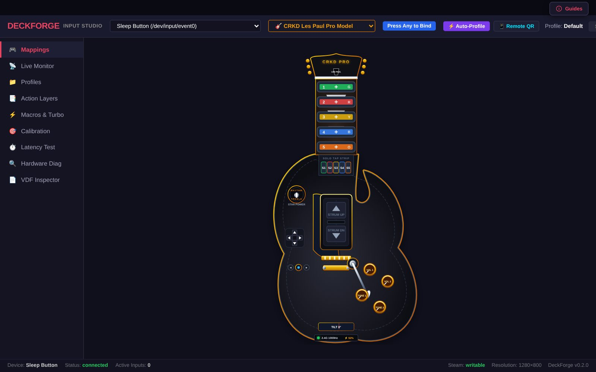
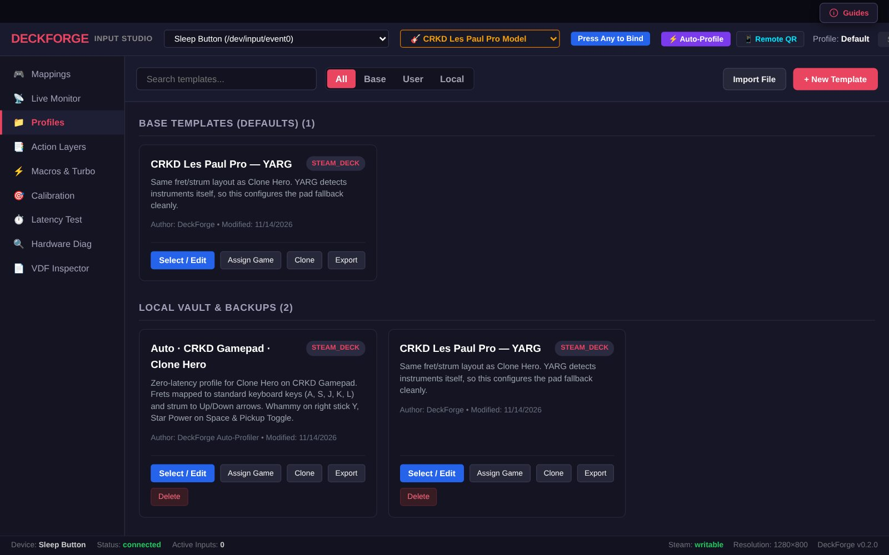
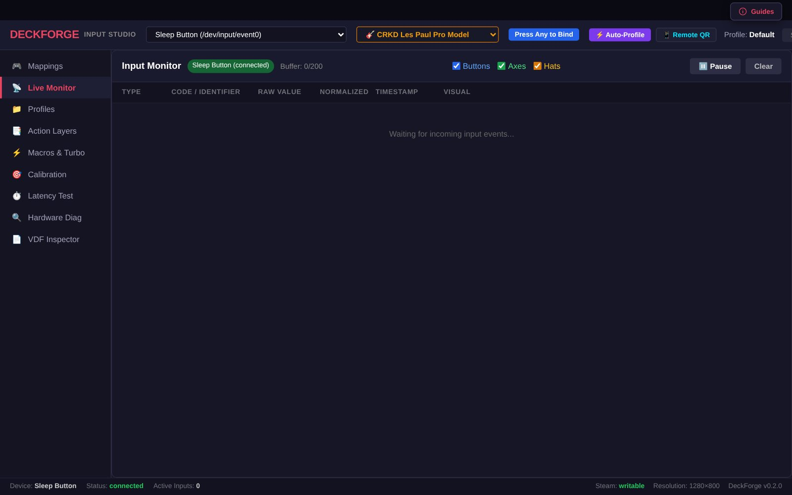
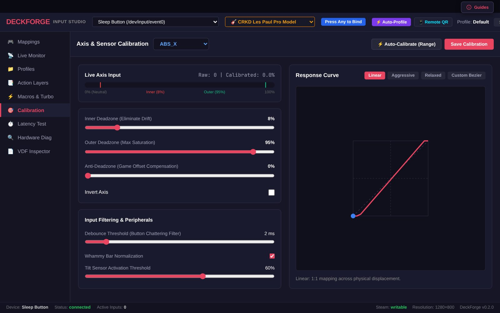
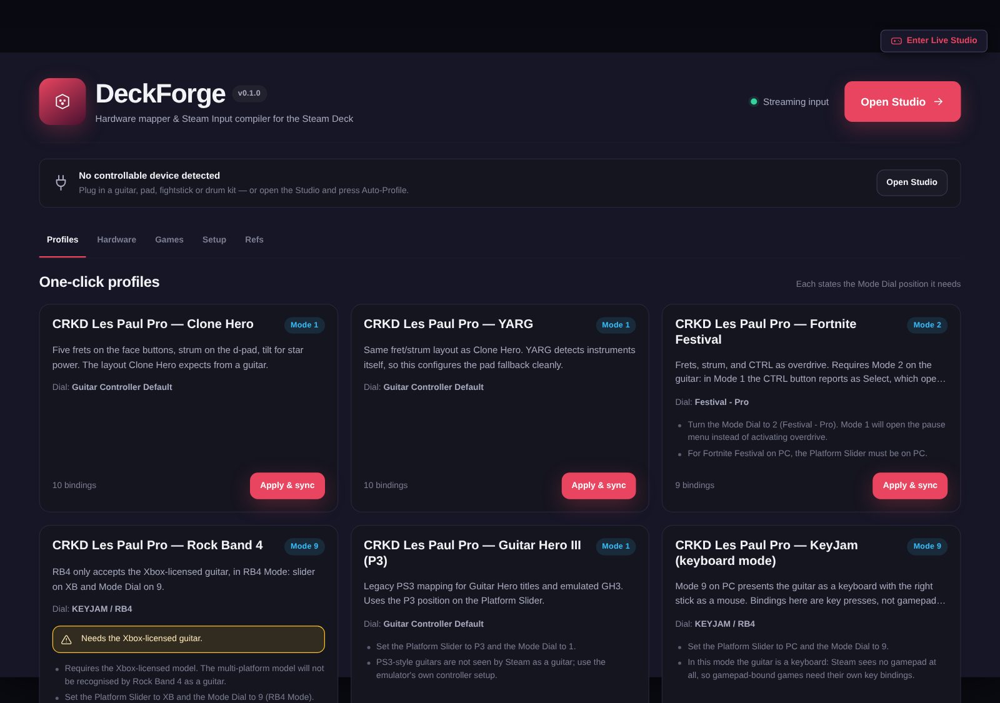
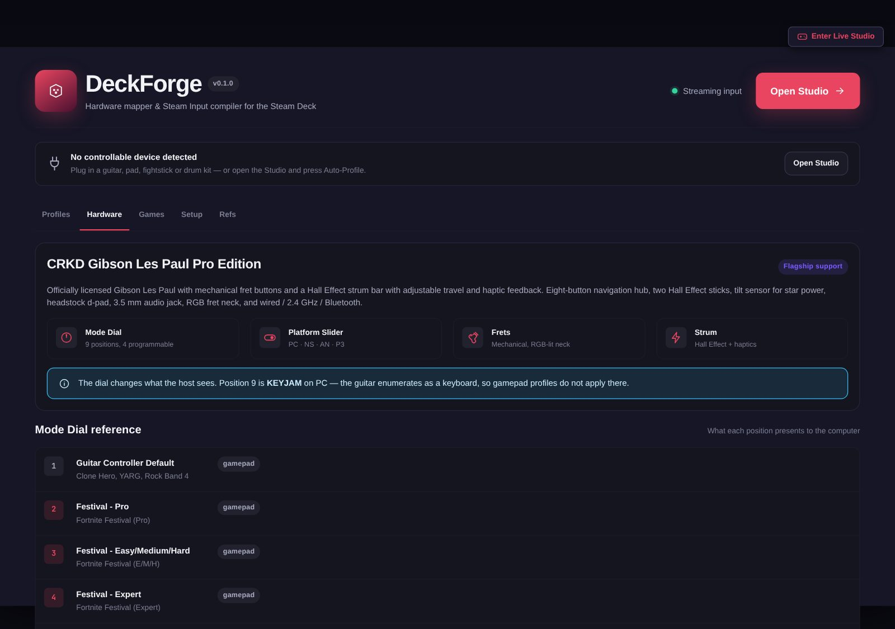
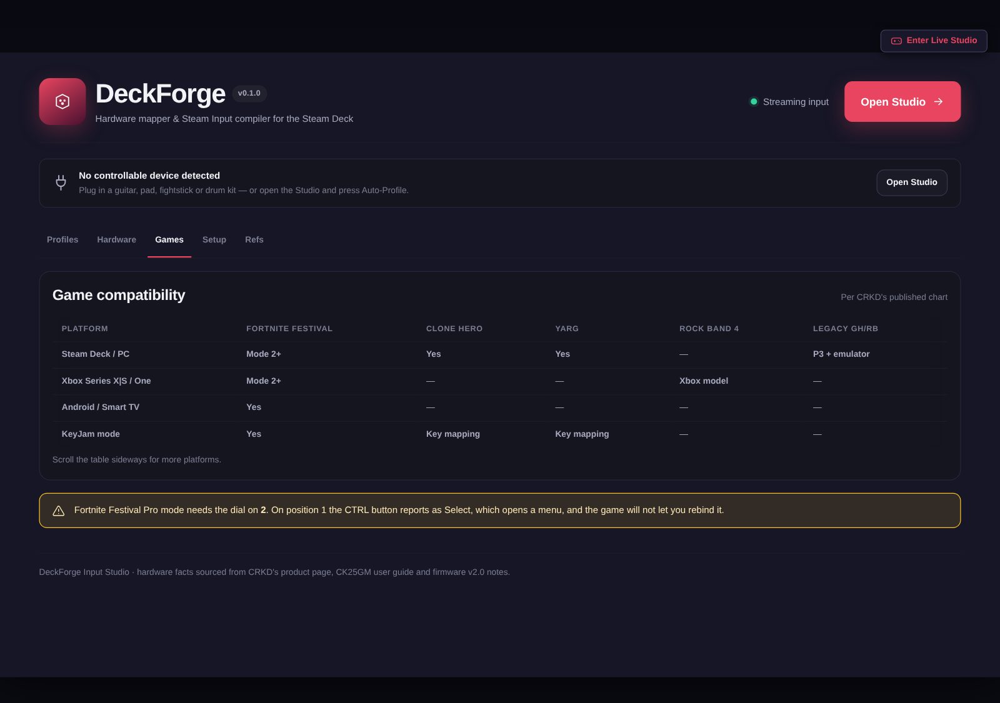
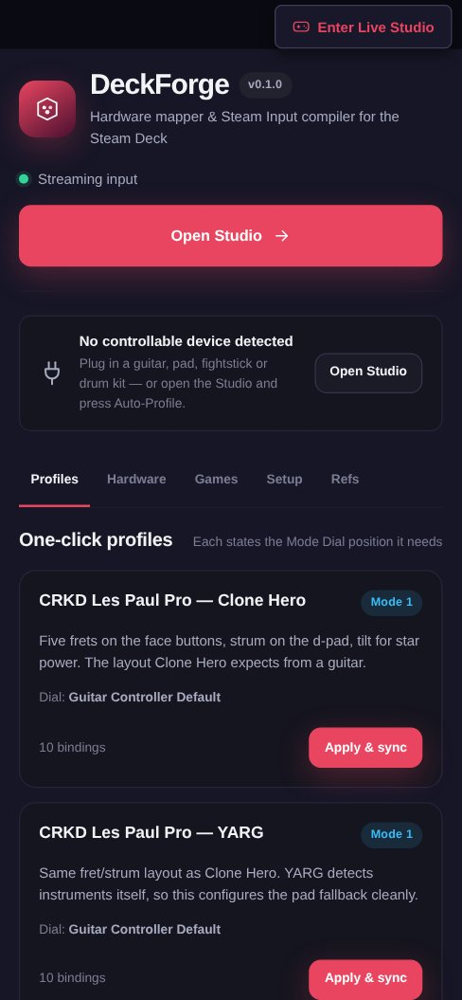

<div align="center">


# DeckForge Input Studio

**Map any controller. Get a real Steam Input profile.**

Stop hand-editing VDFs that Steam silently ignores. Plug in a guitar, a pad, a
drum kit or a fightstick — DeckForge works out what it is, builds a profile that
matches its actual controls, and publishes it where SteamOS really reads it.

[](https://github.com/NaustudentX18/deckforge-input-studio/releases)
[](https://store.steampowered.com/steamos)
[](https://decky.xyz)
[](#-also-a-web-app)
[](https://github.com/NaustudentX18/deckforge-input-studio/actions)
[](LICENSE)

**[Install](#-install)** · **[Screenshots](#-what-it-looks-like)** · **[One-click profiles](#-one-click-profiles)** · **[Why it's hard](#-why-this-is-harder-than-it-looks)** · **[Docs](LAUNCH.md)**

</div>

---

## What it looks like

<table>
<tr>
<td width="50%">

**Auto-profile your guitar**

Every physical control, live, with click-to-bind.

</td>
<td width="50%">

**Profiles, assigned and synced**

Written where Steam actually reads them.

</td>
</tr>
<tr>
<td></td>
<td></td>
</tr>
<tr>
<td>

**Live input monitor**

Raw evdev events, normalised, with jitter.

</td>
<td>

**Per-axis calibration**

Deadzones, response curves, debounce, whammy/tilt.

</td>
</tr>
<tr>
<td></td>
<td></td>
</tr>
</table>

<details>
<summary><b>More screenshots — one-click profiles, hardware reference, mobile</b></summary>

<br>

| One-click profiles | Hardware & Mode Dial |
|---|---|
|  |  |

| Game compatibility | Mobile (PWA) |
|---|---|
|  |  |

</details>

---

## ✨ Features

| | |
|---|---|
| 🎯 **Smart auto-profiler** | One press identifies the hardware and builds a matching profile. Fingerprints what the device actually reports, because the mainstream databases are wrong here. |
| 🎸 **Six one-click profiles** | Clone Hero, YARG, Fortnite Festival, Rock Band 4, Guitar Hero III, KeyJam — each with the Mode Dial position it requires. |
| 🎛 **9 hardware blueprints** | Steam Deck, CRKD Les Paul, NEO S, GP2040-CE, generic guitar, drums, fightstick, macropad, raw HID. Inputs light up live. |
| ⚙️ **Real Steam Input output** | Patches Valve's own skeleton, so Steam always gets a valid group-based config in `controller_base/templates/`. |
| 📊 **Hardware diagnostics** | Polling rate, jitter, switch-bounce histogram, stick circularity. |
| 📱 **PWA + mobile-first UI** | Installs to a phone or tablet home screen, works offline, bottom-bar navigation. |

---

## 🎮 One-click profiles

Each profile is a complete mapping for a specific game — not a generic template.
The **Mode Dial position is part of the profile**, because for some games the
bindings are meaningless without it.

| Profile | Dial | Notes |
|---|---|---|
| Clone Hero | **1** | Frets on face buttons, strum on d-pad, tilt for star power |
| YARG | **1** | Same layout; YARG detects instruments itself |
| Fortnite Festival | **2** | Mode 1 maps CTRL to Select, which opens a menu and can't be rebound in-game |
| Rock Band 4 | **9** | ⚠ Needs the Xbox-licensed model — the multi-platform guitar isn't seen by RB4 |
| Guitar Hero III | **1** | P3 slider position, for emulated GH |
| KeyJam | **9** | Guitar presents as a *keyboard*; bindings are keys |

Applying a profile needs **no device connected** — it's a static template. Only
Auto-Profile reads live hardware.

---

## 💾 Install

### Decky Loader (recommended)

Download the zip from [**Releases**](https://github.com/NaustudentX18/deckforge-input-studio/releases/latest),
then Decky → ⚙️ → **Developer** → *Install from zip*.

Or from a shell on the Deck:

```bash
curl -sL https://raw.githubusercontent.com/NaustudentX18/deckforge-input-studio/main/install.sh | bash
```

The zip is ~12 MB because it vendors the Python dependencies. Decky's interpreter
is a frozen CPython 3.14 that cannot see pip packages, so they must ship inside
the plugin — see [why](#-why-this-is-harder-than-it-looks).

### Then, for a CRKD guitar

```
Platform Slider → PC        Mode Dial → 1
```

Plug in the dongle (or the USB-C cable — both work), power the guitar on, open
the studio and press **⚡ Auto-Profile**. Wired gives the lowest latency.

> Mode **9** on PC switches the guitar into KeyJam, where it enumerates as a
> **keyboard**. Gamepad profiles won't apply there and it looks like the guitar
> is broken.

---

## 🌐 Also a web app

The same UI runs standalone at `http://<deck>:8765` — map on a tablet while
testing live input on the Deck. Over HTTPS (e.g. `tailscale serve`) it installs
as a **PWA** with an offline-capable app shell.

```bash
sudo /opt/tailscale/tailscale serve --bg --https=443 http://127.0.0.1:8765
```

Installation needs a secure context — a plain LAN address will not offer it.

---

## 🧠 Why this is harder than it looks

Three facts, all verified against real hardware or upstream source, that explain
most of the design:

**1. The databases don't know guitars.** SDL classifies the id a CRKD-labelled
unit actually reported as a **PS3 controller**, and its game-controller mapping
database contains **zero** rhythm-guitar entries. So identity is resolved by
fingerprinting the inputs a device physically reports — a guitar has a solo-fret
row and no complete left+right stick pair — then a vendored 613-controller table,
then names.

**2. Steam's schema is group-based.** A `controller_mappings` body is a list of
`group` blocks with fixed named inputs; analog output is a *group setting*
(`output_joystick`), not a binding. There is no `xinput_axis` binding string in
any of the 77 shipped templates. DeckForge therefore **patches Valve's own
skeleton** rather than synthesising one, and reports what it cannot express
(whammy as an axis, the guide button) instead of dropping it silently.

**3. A receiver enumerates with the instrument off.** That produced a
plausible-looking but wrong profile — strum bound to d-pad buttons instead of the
measured hat axis, with nothing flagged as skipped. Now refused with *"is the
controller switched on?"*.

### Hardware notes

- CRKD's own ids are **`0351`/`3651`** (PS4 `1500`/`5500`, PS5 `1600`/`5600`,
  Xbox `4161`). The `20bc:5500` seen from a CRKD-labelled unit belongs to the
  **ShanWan bridge chip** — accepted for detection, but it says nothing about
  which dial position is selected.
- Measured control layout differs from a generic guitar: whammy `ABS_Z`, tilt a
  digital `ABS_HAT0X` edge, strum `ABS_HAT0Y`.

---

## 🛠 Development

```bash
make styles      # regenerate CSS strings (Decky's rollup has no CSS pipeline)
make test        # 128 backend tests
npx tsc --noEmit # type check
bun run build    # both bundles
make zip         # dist/deckforge-input-studio.zip
```

Requirements: Node 20+/Bun, Python 3.14, and `uv` to re-vendor `py_modules/lib`
for **x86_64 / cp314**. See [`HANDOVER.md`](HANDOVER.md) for the architecture and
the traps worth knowing before changing anything.

---

## 📄 License

GPL-2.0-or-later. Peripheral documentation referenced from
[PlasticBand](https://github.com/TheNathannator/PlasticBand) is CC BY-SA 4.0.

<div align="center">
<br>
<sub>Not affiliated with Valve, Gibson, or CRKD.</sub>
</div>
